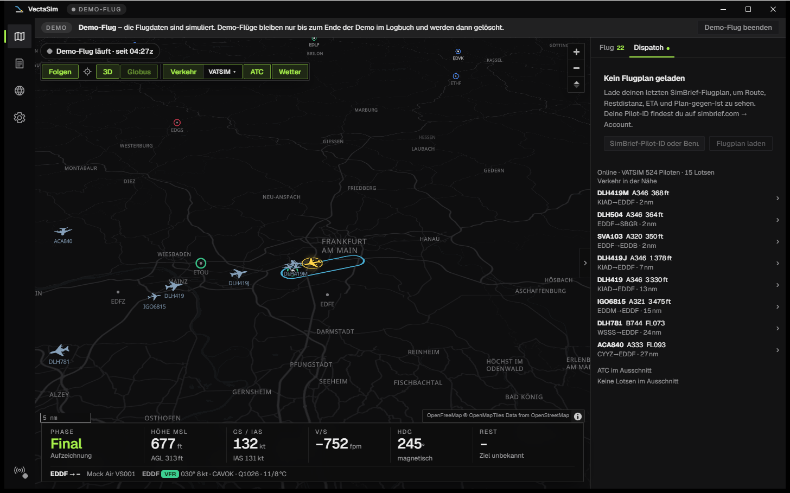
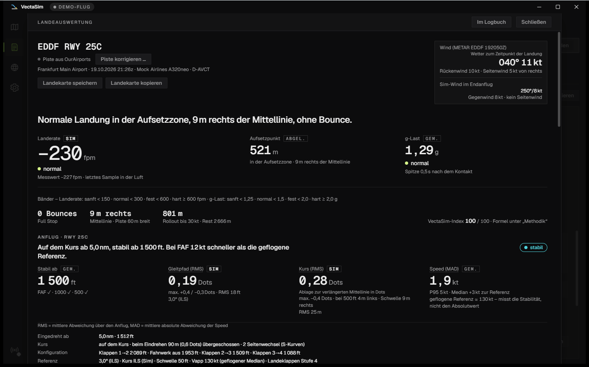
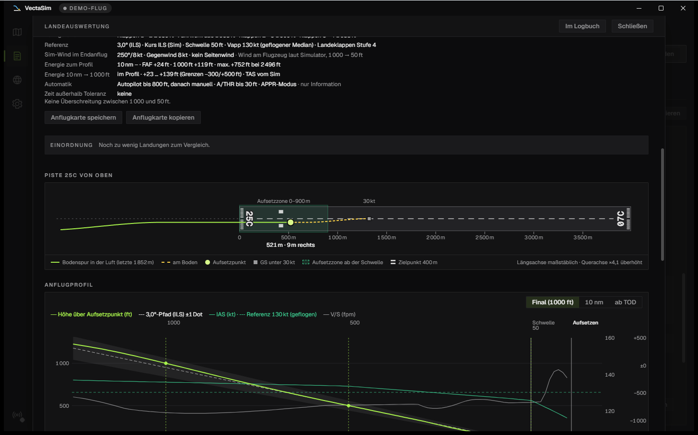
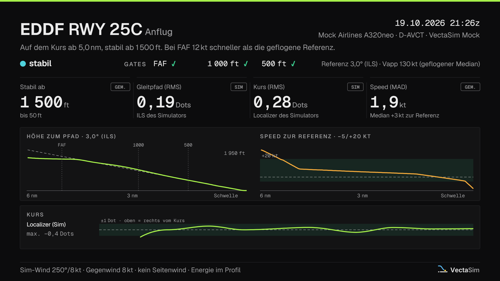
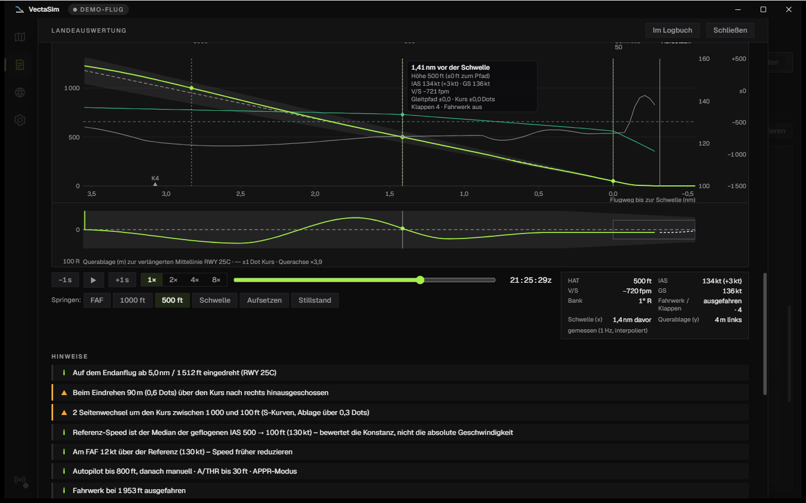
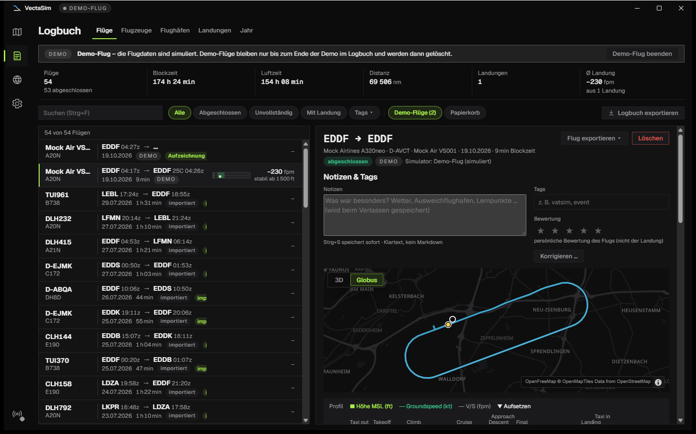
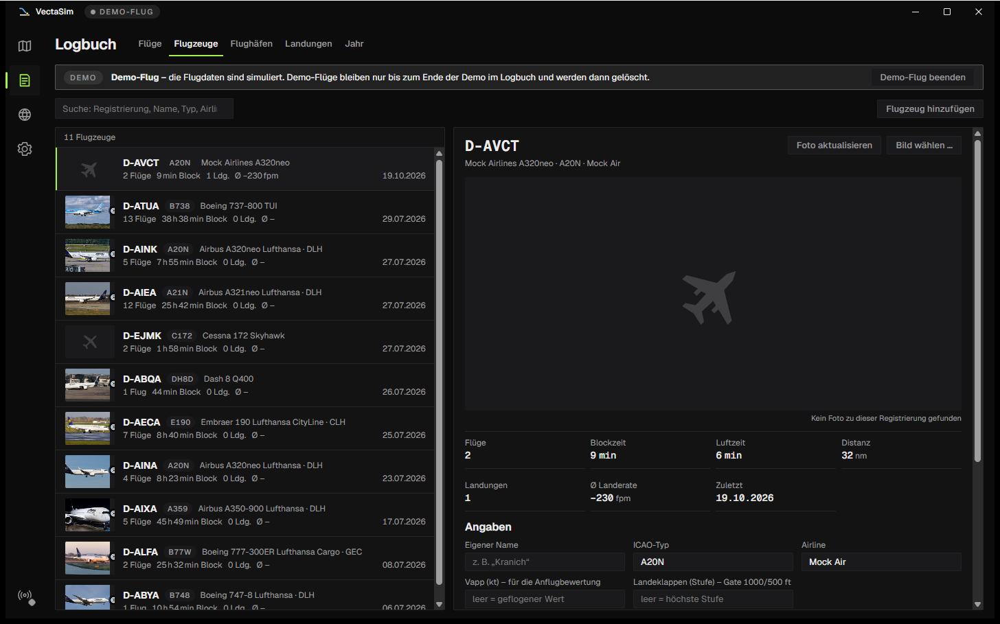
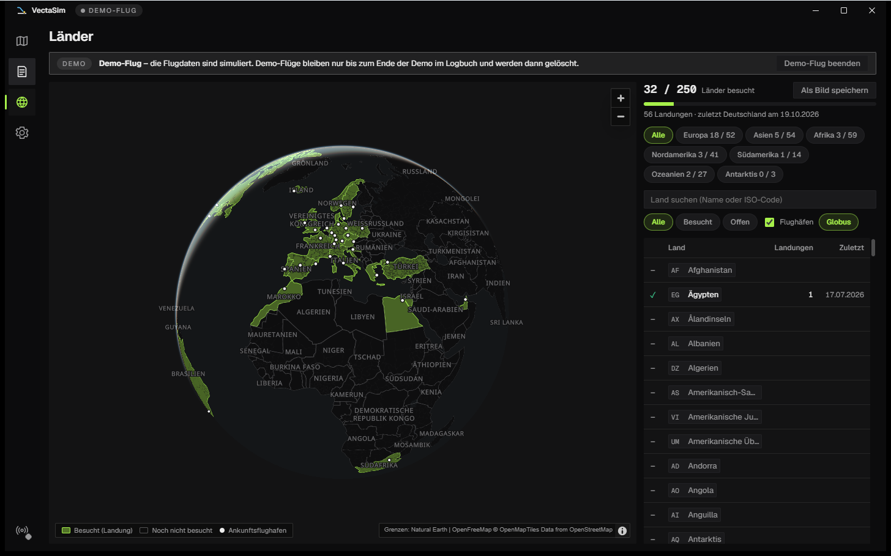

🇬🇧 [English version](README.md)

  

  Flight-Tracker und Logbuch für Flugsimulatoren – leicht, lokal, mit ehrlicher Anflug- und Landeauswertung.

  
  
  
  
  

  

VectaSim läuft neben Microsoft Flight Simulator 2020/2024 und X-Plane 12.1.1 oder neuer, erkennt deinen Flug von selbst vom Losrollen bis zum Abstellen, zeichnet ihn auf und bewertet Anflug und Landung so, dass du den Zahlen trauen kannst. Kein Konto, keine Cloud, kein Abo: Deine Daten bleiben auf deinem PC; VectaSim holt nur Karte, Wetter, Verkehr, Flugpläne und Fotos.

> **Beta.** VectaSim ist für den Flugalltag vollständig und wird jetzt auf echten Setups erprobt. Noch nicht an allen Flugzeugen und Add-ons getestet. Wenn etwas nicht stimmt, hilft ein [Issue](https://github.com/unwritten-dev/VectaSim/issues) mit dem Diagnosepaket aus *Einstellungen → Diagnose* – siehe [Wenn etwas nicht klappt](#wenn-etwas-nicht-klappt).

## Auf einen Blick

| | |
|---|---|
| **Automatisch** | Verbindet sich mit MSFS oder X-Plane 12.1.1+, erkennt Off-Block, Start, Landung und On-Block und legt den Flug ins Logbuch – ohne Knopfdruck. Pause, Slew und Zeitraffer werden markiert, nicht mitgezählt. |
| **Anflug & Landung** | „Stabil ab … ft“, Gates bei 10 nm, FAF, 1000 und 500 ft, Landerate mit Herkunft, Aufsetzpunkt auf der Piste, Bounces, Go-arounds als Entscheidung statt als Fehler. |
| **Live-Karte** | Weltansicht als Globus (umschaltbar auf flach), eigenes Flugzeug, höhencodierter Track, auf Wunsch als 3D-Höhenprofil im Raum mit einem schlichten 3D-Modell deiner Flugzeugklasse in Flughöhe, Flughäfen mit Taxiways und Gates, Online-Verkehr und Lotsen von VATSIM und/oder IVAO (Klick auf ein Flugzeug öffnet eine Flugkarte mit Route, Höhe/Trend, Entfernung und Planespotters-Foto, wenn das Kennzeichen bekannt ist, mit Folgen und Großkreis-Route), METAR-Ringe nach Flugkategorie (VFR/MVFR/IFR/LIFR, erklärt in einer kleinen Legende), auf Wunsch Regenradar und Wolken, Satellitenbild als alternativer Kartengrund, SimBrief-Route, HUD mit Phase, Höhe, Speed, Sinkrate, Restdistanz und ETA. |
| **Logbuch** | Flight-Strips mit Route, Blockzeiten, Landerate und Mini-Runway; Flotte nach Kennzeichen mit Fotos; Flughäfen; Streubilder deiner Aufsetzpunkte und Anflüge; Notizen, Tags, Sterne; Jahresrückblick. |
| **Länder** | Weltkarte als Globus, auf der jedes Land eingefärbt ist, in dem du gelandet bist – mit Fortschritt je Kontinent. |
| **Deine Daten** | Eine SQLite-Datei auf deinem PC, tägliche Sicherung in einen Ordner deiner Wahl (OneDrive, NAS …), Papierkorb, Export als CSV, GPX, KML und JSON, Import alter Logbücher (Volanta, SimToolkitPro, VA-CSV). |
| **Sprachen** | Deutsche und englische Oberfläche, nach der Windows-Anzeigesprache oder von Hand gewählt. |

## Anflug und Landung

  

- **Der ganze Anflug zählt**, nicht nur das Aufsetzen: Gleitpfad und Kurs (Ablage zur verlängerten Mittellinie) in Dots, Speed gegen die geflogene Referenz, Sinkrate, Bank und Konfiguration an jedem Gate – nach den EASA-Kriterien für stabilisierte Anflüge, in vier Bändern von „stabil“ bis „instabil unter 500 ft“; mit Daten aus dem Sim auch gegen das ILS des Simulators statt der 3°-Annahme, mit Sim-Wind im Endanflug, Schub, Spoilern und Landeklappen. ILS-Referenz und Sim-Wind gelten für Flüge, die mit dieser Version aufgezeichnet wurden; ältere Flüge und X-Plane-Flüge werden über die Pistengeometrie und die 3°-Annahme bewertet. Der Kurs – die Ablage zur verlängerten Mittellinie – bekommt dazu eine eigene Kennzahl mit eigenem Band (RMS und max. in Dots, Ablage bei 500 ft und über der Schwelle, Überschießen beim Eindrehen, S-Kurven).
- **Energie und Wind:** ein Energieband von 10 nm bis 1000 ft, dazu Hinweise auf Rückenwind, Seitenwind und Windscherung im Endanflug.
- **Landerate nach festen, dokumentierten Regeln:** Sim-Wert mit Rückfall auf die letzte Sinkrate in der Luft, härtester Kontakt bei Bounces, kein Flug-Peak – die G-Last über den ganzen Flug steht getrennt davon im Flugdetail. Jede Zahl zeigt ihre Herkunft (Sim · gemessen · abgeleitet).
- **Pisten-Draufsicht** mit Aufsetzpunkt, Mittellinien-Versatz, Aufsetzzone und Zielpunkt, **Anflugprofil** gegen den 3°-Gleitpfad mit Replay-Cursor, Abfangen, Rollout und der Wind aus dem METAR zum Landezeitpunkt. Pisten, die in der Flughafendatenbank fehlen, leitet VectaSim aus deiner Bodenspur ab (markiert als „abgeleitet“, Schwelle ±50 m); mit *Piste korrigieren …* setzt du Schwelle und Ende genau.
- **Durchstarten ist eine Entscheidung:** Ein Go-around bekommt seinen eigenen Debrief mit tiefstem Punkt, der abgebrochene Anflug wird vollständig bewertet. *Platzrunden* im Flugdetail listet jedes Touch-and-go auf.
- **Du gegen dich:** Jede Landung wird gegen deine eigenen eingeordnet („besser als 70 % deiner letzten 20 auf EDDF 25C“), *Landungen → Verlauf* zeigt den gleitenden Median über Wochen und Monate, das Streubild die letzten 20 Aufsetzpunkte und Anflüge.
- **Landekarte zum Teilen** (1200 × 675 PNG) mit Runway, Mini-Anflugprofil, den vier Kennzahlen und Wind – in die Zwischenablage oder als Datei, auf Wunsch nach jeder Landung automatisch; dazu eine **Anflugkarte** mit Band, Gates, Profil und Kurs, die bei eingeschaltetem automatischem Speichern neben der Landekarte mitgespeichert wird.

<table align="center">
  <tr>
    <td></td>
    <td></td>
  </tr>
</table>

  

**Der Kurs** bekommt eine eigene Kennzahl neben dem Gleitpfad: die Ablage zur verlängerten Mittellinie in Dots (Localizer des Simulators, sonst Geometrie), ein eigenes Band (auf dem Kurs · leichte Ablage · deutliche Ablage), die Ablage bei 500 ft und über der Schwelle, Überschießen beim Eindrehen und S-Kurven – und der Streifen unter dem Anflugprofil zeigt das ganze seitliche Bild auf einen Blick.

## Logbuch, Flotte und Länder

  

- **Flight-Strips:** Rufzeichen und Muster, Route mit Blockzeiten, Landerate, „stabil ab … ft“, Go-arounds und eine kleine Runway mit dem Aufsetzpunkt – eine Liste, die Muster zeigt. Suche und Filter über alles, auch Notizen und Tags.
- **Flugdetail:** Höhen- und Speed-Profil mit Phasen, Track-Karte mit **Wiedergabe** des ganzen Flugs (1× bis 64×, die Karte kann dem Flugzeug folgen, in 3D in seiner Höhe), Zeiten, Treibstoff, Plan gegen Ist (Blockzeit, Trip-Fuel, Landetreibstoff, Pünktlichkeit) und ein PIREP für VA-Formulare als Text oder JSON.
- **Flotte** (Logbuch → Flugzeuge): Flüge landen immer auf demselben Flugzeug (Kennzeichen), mit Foto von Planespotters.net oder eigenem Bild, eigener Vapp und Landeklappenstellung (z. B. 3 für CONF 3) für die Anflugbewertung.
- **Notizen, Tags, Sterne** je Flug; falsch aufgezeichnete Werte (Rufzeichen, Flughäfen, Flugzeug, Kennzeichen) lassen sich korrigieren – das Original bleibt erhalten.
- **Nach einem Absturz:** Bist du innerhalb von 30 Minuten und 5 nm von der letzten Position zurück, bietet VectaSim an, den Flug fortzusetzen; sonst fügt *Zusammenführen* über dem Logbuch beide Teile zu einem Flug zusammen.
- **SimBrief:** Mit hinterlegter Pilot-ID lädt VectaSim den aktuellen Flugplan von selbst, zeigt die Route auf der Karte und vergleicht Plan und Ist.
- **Import:** Alte Flüge aus Volanta (Import-CSV), SimToolkitPro, VA-Exporten oder dem eigenen Logbuch-CSV – mit Spaltenzuordnung, Vorschau und Duplikaterkennung. Trennzeichen, Zeichenkodierung und Format werden automatisch erkannt; gängige Datumsformate, Zeiten in UTC oder Ortszeit, Gewichte in kg oder lb, Dateien bis 50 MB. Eine Landerate aus der Datei landet in den Notizen; importierte Flüge bekommen den Tag `import` und zählen für Stunden, Strecken, Flotte und Länder.
- **Jahresrückblick: Story-Karten als PNG** („Dein Jahr 2026“, Logbuch → Jahr): sieben Karten – Überblick, Strecken mit Weltkarte, Flotte, Landungen mit Jahres-Streubild, Anflüge, Monate, Länder – plus eine optionale achte, „Mit Sternchen“ (Flüge mit Pause, Zeitraffer, Slew oder Positionssprung). Im Story-Hochformat 1080 × 1920 oder quer 1200 × 675, für ein Kalenderjahr oder die letzten 12 Monate. Einzeln speichern oder kopieren, mit *Alle einzeln speichern* in einen Ordner oder mit *Alle als ein langes Bild* als Hochformat-Stapel; der Streamer-Modus maskiert die Kennzeichen.

  

  

**Länder** (Strg+3): Jedes Land, in dem du gelandet bist, wird eingefärbt – nur die Ankunft zählt. Fortschritt gesamt und je Kontinent, erste und letzte Landung je Land, ein Klick zeigt die Flüge dorthin; die Karte lässt sich als Bild speichern.

## Oberfläche

- Vier Ansichten – Karte, Logbuch, Länder, Einstellungen (Strg+1 bis 4) – und sechs Themes (Signal, Nachtcockpit, Graphit & Amber, Phosphor sowie die Tagesthemen Papierkarte und Arktis Studio). Zeiten in UTC oder Ortszeit, Gewichte in kg oder lb, Oberfläche mit Strg+Plus/Minus skalierbar.
- **Tastatur:** Strg+F sucht im Logbuch, Strg+. klappt das Seitenpanel der Karte ein und aus, die Eingabetaste öffnet die Landeauswertung des gewählten Flugs, Entf legt ihn in den Papierkorb, Alt+T springt zum neuesten Hinweis – die vollständige Liste steht unter *Einstellungen → Tastatur*.
- **Karte:** Globus oder flache Karte in der Kartenleiste oder unter *Einstellungen → Anzeige* umschalten; die 3D-Ansicht mit der rechten Maustaste oder Strg + Ziehen drehen und neigen.
- **Deutsch und Englisch:** *Einstellungen → Anzeige → Sprache* – System (folgt der Windows-Anzeigesprache), Deutsch oder English, wirkt sofort. Benachrichtigungen, Tray-Menü, Discord-Status, Overlays und Installer folgen derselben Einstellung; Flugphasen stehen immer auf Englisch.
- **Streamer-Modus** (Strg+Umschalt+P) blendet Kennzeichen, Rufzeichen, Airline, SimBrief-ID und Benutzerpfade überall aus – auch auf der Landekarte und im Diagnosepaket.
- **Landerate im Sim (MSFS):** Einige Sekunden nach dem Aufsetzen zeigt eine Zeile oben im Bild Rate, Einstufung, g, Bounces und Aufsetzpunkt, z. B. „VectaSim · Gelandet −142 fpm (sanft) · 1,18 g · keine Bounces · 27L: 412 m hinter der Schwelle, 1 m links“ (*Einstellungen → Simulator*, standardmäßig an; hängt davon ab, ob die MSFS-Version SimConnect-Text anzeigt).
- **Integrationen** (alle optional, außer Benachrichtigungen und Tray-Symbol standardmäßig aus): Discord-Status mit Route und Phase (standardmäßig aus, einschalten unter *Einstellungen → Integrationen*; keine eigene Discord-Anwendung nötig – die Aktivitätsfreigabe muss in Discord erlaubt sein), Windows-Benachrichtigungen (Landung, Flug gespeichert, Verbindung, Update), ein Symbol im Infobereich: Minimieren oder Schließen lässt VectaSim dort weiterlaufen (samt Aufzeichnung); Doppelklick auf das Symbol öffnet es wieder, *Beenden* im Menü beendet die App (abschaltbar unter *Einstellungen → Integrationen*).
- **Overlay & Schnittstelle** (standardmäßig aus): lokaler Server mit transparenten OBS-Overlays (HUD, Landung, Route); Overlays und Startseite lassen sich auf Tablet oder Handy im WLAN öffnen (mit Token); dazu eine nur lesende JSON/WebSocket-Schnittstelle für VAs. Overlays verstehen `?lang=de|en` – Endpunkte und Sicherheit in [docs/overlay-api.md](docs/overlay-api.md) (englisch).
- **Datensicherheit:** tägliche Sicherung (die letzten 7 täglichen Sicherungen bleiben erhalten), zusätzlich vor jedem Update und jeder Umstellung des Datenformats, in einen frei wählbaren Ordner; Wiederherstellen mit einem Klick; gelöschte Flüge liegen 30 Tage im Papierkorb; Gesamtexport als `.vectasim`-Datei für den Umzug auf einen anderen PC. *Papierkorb leeren* und *Alle Daten löschen* stehen unter *Einstellungen → Daten*.
- **Demo-Flug** ohne Simulator zum Ausprobieren – beginnt in der Luft im Gegenanflug auf Frankfurt und landet nach etwa 4 Minuten, normal, mit ein paar kleinen, bewusst eingebauten Fehlern, damit die Nachbesprechung etwas zeigt. Demo-Flüge werden entfernt, sobald die Demo endet; bis dahin erscheinen sie in Logbuch und Statistiken nur mit dem Filter „Demo-Flüge“.
- **Updates:** Automatische Updates werden mit VectaSims eigener Signatur geprüft; der Installer selbst ist für Windows noch nicht code-signiert. Während eines aufgezeichneten Flugs warten Updates, bis der Flug vorbei ist, und Beenden fragt erst nach (der Flug wird dann als unterbrochen gespeichert).

## Systemvoraussetzungen

- Windows 10 oder 11, 64-bit, mit WebView2 (auf aktuellen Windows-Versionen vorinstalliert).
- Microsoft Flight Simulator 2020 oder 2024 (Microsoft Store oder Steam) oder X-Plane 12.1.1 oder neuer, auf demselben PC.
- Eine Internetverbindung für die Karte und Online-Daten (Wetter, Verkehr, Flugpläne, Fotos).
- Ein Fenster von mindestens 1024 × 640.

## Installation

1. Unter [Releases](https://github.com/unwritten-dev/VectaSim/releases) die neueste Version öffnen und `VectaSim_<version>_x64-setup.exe` herunterladen (Windows 10/11, 64-bit).
2. Installer starten. Windows SmartScreen meldet „unbekannter Herausgeber“ (die Beta ist noch nicht code-signiert) → *Weitere Informationen → Trotzdem ausführen*. Keine Adminrechte nötig.
3. Für MSFS braucht VectaSim die `SimConnect.dll` von Microsoft. Der Installer fragt am Ende, ob er sie von Microsoft holen soll – ein Klick, ca. 108 MB; er prüft die Datei und behält nur die DLL (ist das MSFS-SDK schon installiert, fragt er gar nicht erst). Später geht es auch in *Einstellungen → Simulator → SimConnect herunterladen*. X-Plane braucht keine zusätzliche Datei – wer nur X-Plane fliegt, antwortet mit „Nein“.
4. MSFS oder X-Plane starten. Sobald der Sim im Hauptmenü ist (MSFS) bzw. ein Flug geladen ist (X-Plane), zeigt die Karte „Bereit“; die Aufzeichnung beginnt beim Losrollen.

*Einstellungen → Simulator* steht standardmäßig auf *Automatisch*: Findet VectaSim innerhalb von 10 Sekunden kein MSFS, versucht es X-Plane. Wer nur X-Plane fliegt, wählt „X-Plane 12“. Für X-Plane muss in X-Plane unter *Settings → Network* die Option „Disable Incoming Traffic“ ausgeschaltet bleiben, sonst ist die Web API gesperrt.

Updates meldet VectaSim beim Start und installiert sie nach Bestätigung. Mehr Details, der Weg über das SDK, die X-Plane-Einrichtung und die Fehlersuche stehen (auf Englisch) in [docs/installation.md](docs/installation.md).

## Deine Daten & Datenschutz

- Dein Logbuch liegt in `%APPDATA%\io.vectasim.app\`; Protokolle und der Standardordner für Sicherungen liegen in `%LOCALAPPDATA%\io.vectasim.app\`.
- VectaSim nimmt nur Kontakt auf zu: OpenFreeMap (Kartenkacheln), EOX (Satellitenkacheln, nur mit „Satellit“), RainViewer und EUMETSAT (Radar und Wolken, nur wenn eingeschaltet), aviationweather.gov (METAR), VATSIM und IVAO (nur wenn eingeschaltet), SimBrief (nur mit deiner Pilot-ID), Planespotters.net (Flugzeugfotos, abschaltbar), GitHub (Updates) und dem SDK-Server von Microsoft (nur für den SimConnect-Download).

## Deinstallieren

Windows-*Einstellungen → Apps → VectaSim → Deinstallieren*. Dein Logbuch bleibt erhalten, außer du setzt den Haken bei „Anwendungsdaten löschen“ – das entfernt auch die Sicherungen im Standardordner, also vorher eine Sicherung an einem anderen Ort ablegen.

## Wenn etwas nicht klappt

*Einstellungen → Diagnose* zeigt Verbindung, gefundene DLL und Datenrate; *Diagnose kopieren* legt eine kurze Zusammenfassung in die Zwischenablage. Für einen Fehlerbericht: **Debug-Modus** einschalten, den Fehler nachstellen, **Diagnosepaket erstellen** – die ZIP-Datei (Protokolle, Einstellungen, Simulator-Aufzeichnung; ohne Passwörter oder Schlüssel) an ein [Issue](https://github.com/unwritten-dev/VectaSim/issues) hängen. Danach den Debug-Modus wieder ausschalten.

## Bekannte Einschränkungen

- **X-Plane:** 10 Werte pro Sekunde, kein Aufsetzwert aus dem Sim – die Landerate ist „gemessen“ (etwa ±50–100 fpm), keine ILS-Referenz, nur auf demselben PC.
- Importierte Flüge haben keinen Track und keine Landeauswertung.
- Abgeleitete Pisten sind auf etwa ±50 m genau.
- Flugphasen stehen immer auf Englisch.
- Der Installer ist noch nicht code-signiert.

## Status

Beta 0.5 – MSFS 2020/2024 und X-Plane 12.1.1+ (Web API), Oberfläche auf Deutsch und Englisch. Geplant: Volanta-Import aus dem JSON-Export, Code-Signing – Ideen gern als [Issue](https://github.com/unwritten-dev/VectaSim/issues). Was sich geändert hat, steht im [CHANGELOG](CHANGELOG.md) (englisch).

## Mitmachen

Alles für Entwicklerinnen und Entwickler – Stack, Bauen aus dem Quellcode, Architektur, Konventionen – steht in [DEVELOPMENT.md](DEVELOPMENT.md) (englisch).

## Daten und Danke

Karte: © [OpenStreetMap](https://www.openstreetmap.org/copyright)-Mitwirkende, Tiles von [OpenFreeMap](https://openfreemap.org) · Satellitenbild: [EOxCloudless](https://cloudless.eox.at) von EOX IT Services GmbH (enthält veränderte Copernicus-Sentinel-Daten 2017, CC BY 4.0) · Flughäfen: [OurAirports](https://ourairports.com) (Public Domain) · Ländergrenzen: [Natural Earth](https://www.naturalearthdata.com) (Public Domain) · Wetter: NOAA aviationweather.gov, Radar von [RainViewer](https://www.rainviewer.com), Wolken: enthält veränderte Meteosat-Daten von [EUMETSAT](https://www.eumetsat.int) · Online-Verkehr: [VATSIM](https://vatsim.net) · [IVAO](https://ivao.aero) · Flugpläne: [SimBrief](https://www.simbrief.com) · Flugzeugfotos: [Planespotters.net](https://www.planespotters.net) mit Fotografen-Credit.

SimConnect ist Bestandteil des Microsoft Flight Simulator SDK und wird nicht mitgeliefert; auf Wunsch lädt VectaSim die `SimConnect.dll` aus dem offiziellen SDK-Download von Microsoft.

Lizenzen der verwendeten Bibliotheken, Schriften und Daten: [THIRD-PARTY-NOTICES.md](THIRD-PARTY-NOTICES.md).

## Lizenz

MIT – siehe [LICENSE](LICENSE).
