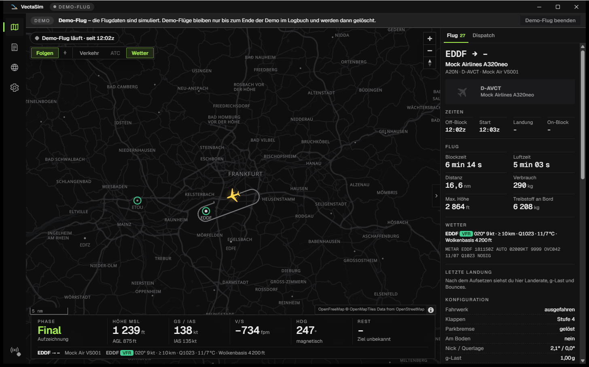
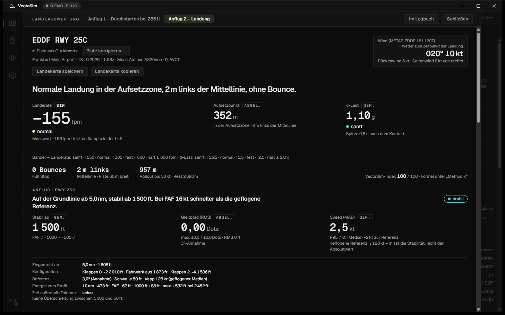
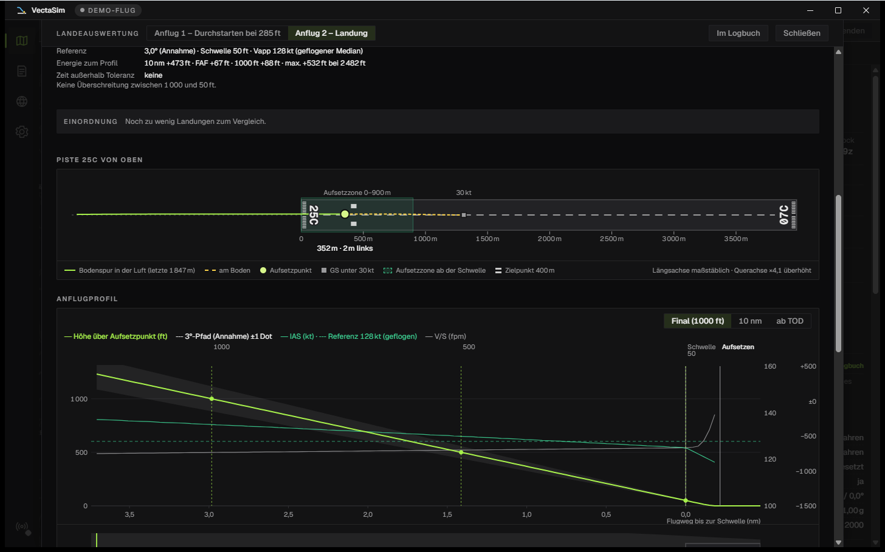
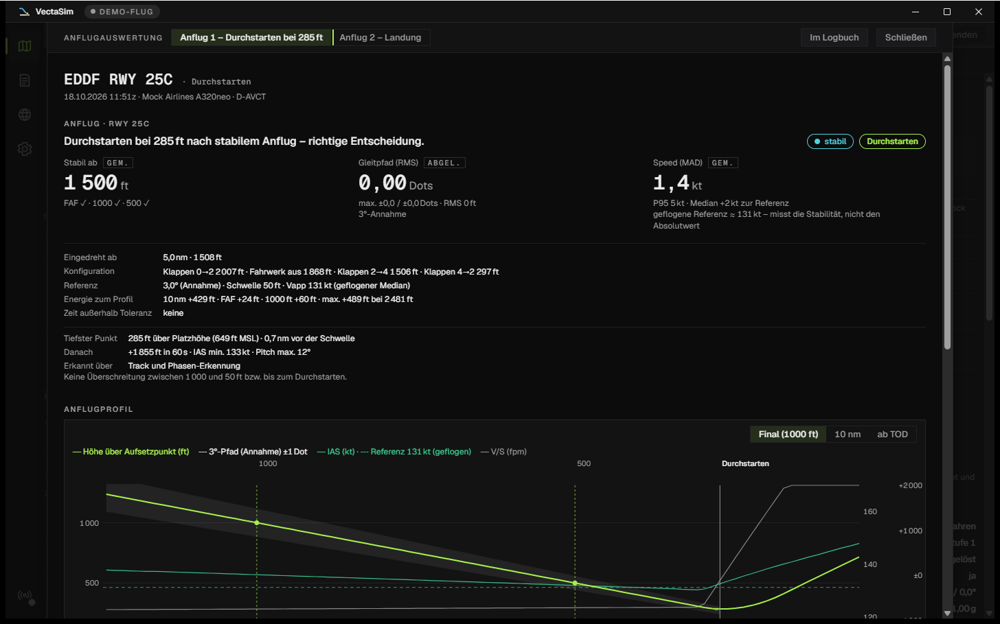
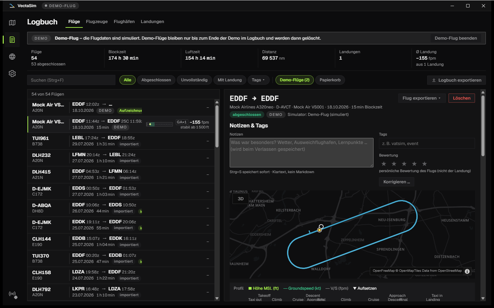
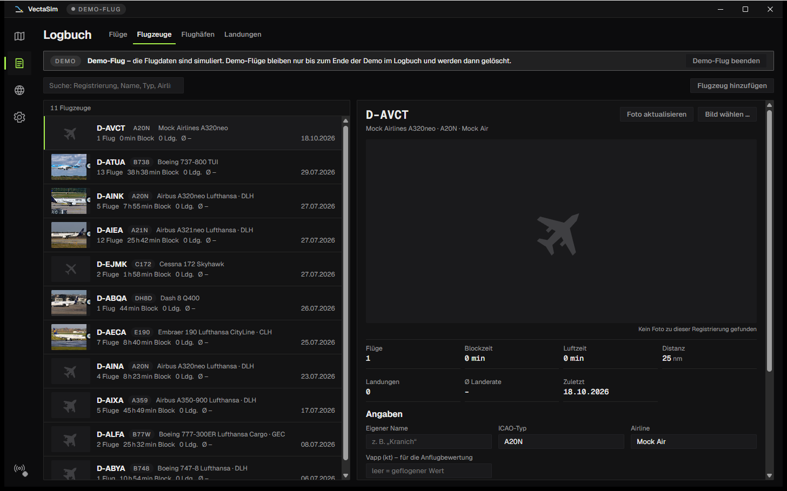
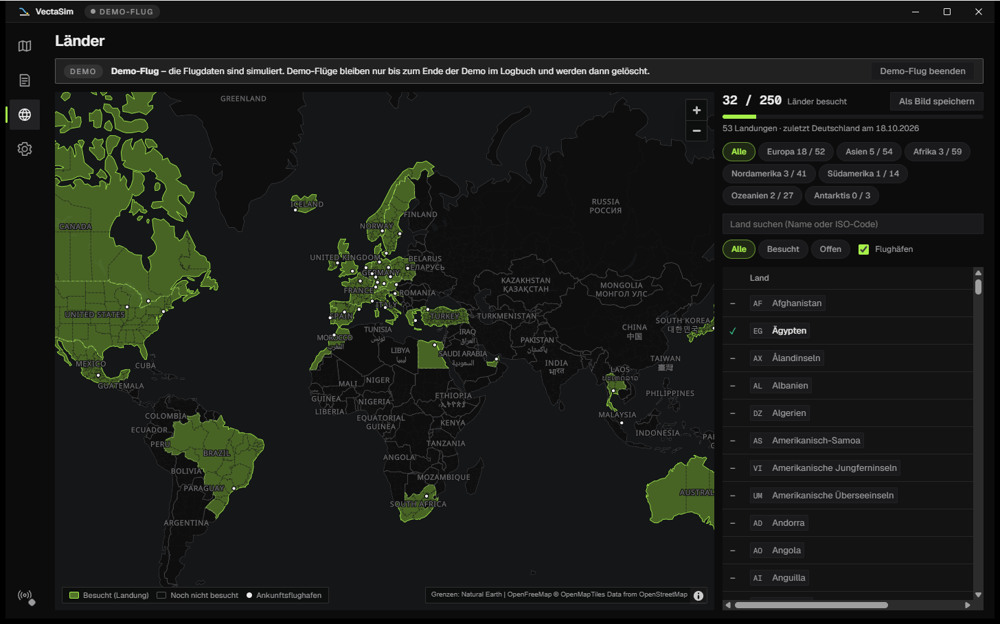

  

  Flight-Tracker und Logbuch für Flugsimulatoren – leicht, lokal, mit ehrlicher Anflug- und Landeauswertung.

  
  
  
  

  

VectaSim läuft neben Microsoft Flight Simulator 2020/2024, erkennt deinen Flug von selbst vom Losrollen bis zum Abstellen, zeichnet ihn auf und bewertet Anflug und Landung so, dass du den Zahlen trauen kannst. Alles bleibt auf deinem PC – kein Konto, keine Cloud, kein Abo.

> **Alpha.** Dies ist die erste öffentliche Vorabversion. Sie ist stabil genug zum Mitfliegen, aber noch nicht an allen Flugzeugen und Add-ons erprobt. Wenn etwas nicht stimmt, hilft ein [Issue](https://github.com/unwritten-dev/VectaSim/issues) mit dem Diagnosepaket aus *Einstellungen → Diagnose* – siehe [Wenn etwas nicht klappt](#wenn-etwas-nicht-klappt).

## Auf einen Blick

| | |
|---|---|
| **Automatisch** | Verbindet sich mit MSFS, erkennt Off-Block, Start, Landung und On-Block und legt den Flug ins Logbuch – ohne Knopfdruck. Pause, Slew und Zeitraffer werden markiert, nicht mitgezählt. |
| **Anflug & Landung** | „Stabil ab … ft“, Gates bei 10 nm, FAF, 1000 und 500 ft, Landerate mit Herkunft, Aufsetzpunkt auf der Piste, Bounces, Go-arounds als Entscheidung statt als Fehler. |
| **Live-Karte** | Eigenes Flugzeug, höhencodierter Track, auf Wunsch als 3D-Höhenprofil im Raum, Flughäfen mit Taxiways und Gates, VATSIM-Verkehr, METAR, SimBrief-Route, HUD mit Phase, Höhe, Speed, Sinkrate, Restdistanz und ETA. |
| **Logbuch** | Flight-Strips mit Route, Blockzeiten, Landerate und Mini-Runway; Flotte nach Kennzeichen mit Fotos; Flughäfen; Streubilder deiner Aufsetzpunkte und Anflüge; Notizen, Tags, Sterne. |
| **Länder** | Weltkarte, auf der jedes Land eingefärbt ist, in dem du gelandet bist – mit Fortschritt je Kontinent. |
| **Deine Daten** | Eine SQLite-Datei auf deinem PC, tägliche Sicherung in einen Ordner deiner Wahl (OneDrive, NAS …), Papierkorb, Export als CSV, GPX, KML und JSON, Import alter Logbücher (Volanta, SimToolkitPro, VA-CSV). |

## Anflug und Landung

  

- **Der ganze Anflug zählt**, nicht nur das Aufsetzen: Gleitpfad und Grundlinie in Dots, Speed gegen die geflogene Referenz, Sinkrate, Bank und Konfiguration an jedem Gate – nach den EASA-Kriterien für stabilisierte Anflüge, in vier Bändern von „stabil“ bis „instabil unter 500 ft“.
- **Landerate nach festen, dokumentierten Regeln:** Sim-Wert mit Rückfall auf die letzte Sinkrate in der Luft, härtester Kontakt bei Bounces, kein Flug-Peak. Jede Zahl zeigt ihre Herkunft (Sim · gemessen · abgeleitet).
- **Pisten-Draufsicht** mit Aufsetzpunkt, Mittellinien-Versatz, Aufsetzzone und Zielpunkt, **Anflugprofil** gegen den 3°-Gleitpfad mit Replay-Cursor, Abfangen, Rollout und der Wind aus dem METAR zum Landezeitpunkt.
- **Durchstarten ist eine Entscheidung:** Ein Go-around bekommt seinen eigenen Debrief mit tiefstem Punkt, der abgebrochene Anflug wird vollständig bewertet.
- **Du gegen dich:** Jede Landung wird gegen deine eigenen eingeordnet („besser als 70 % deiner letzten 20 auf EDDF 25C“), *Landungen → Verlauf* zeigt den gleitenden Median über Wochen und Monate, das Streubild die letzten 20 Aufsetzpunkte und Anflüge.
- **Landekarte zum Teilen** (1200 × 675 PNG) mit Runway, Mini-Anflugprofil, den vier Kennzahlen und Wind – in die Zwischenablage oder als Datei, auf Wunsch nach jeder Landung automatisch.

<table align="center">
  <tr>
    <td></td>
    <td></td>
  </tr>
</table>

## Logbuch, Flotte und Länder

  

- **Flight-Strips:** Rufzeichen und Muster, Route mit Blockzeiten, Landerate, „stabil ab … ft“, Go-arounds und eine kleine Runway mit dem Aufsetzpunkt – eine Liste, die Muster zeigt. Suche und Filter über alles, auch Notizen und Tags.
- **Flugdetail:** Höhen- und Speed-Profil mit Phasen, Track-Karte, Zeiten, Treibstoff, Plan gegen Ist (Blockzeit, Trip-Fuel, Landetreibstoff, Pünktlichkeit) und ein PIREP für VA-Formulare als Text oder JSON.
- **Flotte:** Flüge landen immer auf demselben Flugzeug (Kennzeichen), mit Foto von Planespotters.net oder eigenem Bild und eigener Vapp für die Anflugbewertung.
- **Notizen, Tags, Sterne** je Flug; falsch aufgezeichnete Werte (Rufzeichen, Flughäfen, Flugzeug, Kennzeichen) lassen sich korrigieren – das Original bleibt erhalten.
- **SimBrief:** Mit hinterlegter Pilot-ID lädt VectaSim den aktuellen Flugplan von selbst, zeigt die Route auf der Karte und vergleicht Plan und Ist.
- **Import:** Alte Flüge aus Volanta (Import-CSV), SimToolkitPro, VA-Exporten oder dem eigenen Logbuch-CSV – mit Spaltenzuordnung, Vorschau und Duplikaterkennung. Importierte Flüge zählen für Stunden, Strecken, Flotte und Länder.

  

  

**Länder** (Strg+3): Jedes Land, in dem du gelandet bist, wird eingefärbt – nur die Ankunft zählt. Fortschritt gesamt und je Kontinent, erste und letzte Landung je Land, ein Klick zeigt die Flüge dorthin; die Karte lässt sich als Bild speichern.

## Oberfläche

- Vier Ansichten – Karte, Logbuch, Länder, Einstellungen (Strg+1 bis 4) – und sechs Themes (Signal, Nachtcockpit, Graphit & Amber, Phosphor sowie die Tagesthemen Papierkarte und Arktis Studio). Zeiten in UTC oder Ortszeit, Gewichte in kg oder lb, Oberfläche mit Strg+Plus/Minus skalierbar.
- **Streamer-Modus** (Strg+Umschalt+P) blendet Kennzeichen, Rufzeichen, Airline, SimBrief-ID und Benutzerpfade überall aus – auch auf der Landekarte und im Diagnosepaket.
- **Integrationen** (alle abschaltbar): Discord-Status mit Route und Phase, Windows-Benachrichtigungen (Landung, Flug gespeichert, Verbindung, Update), Minimieren in den Infobereich.
- **Datensicherheit:** tägliche Sicherung, zusätzlich vor jedem Update und jeder Umstellung des Datenformats, in einen frei wählbaren Ordner; Wiederherstellen mit einem Klick; gelöschte Flüge liegen 30 Tage im Papierkorb; Gesamtexport als `.vectasim`-Datei für den Umzug auf einen anderen PC.
- **Demo-Flug** ohne Simulator zum Ausprobieren; signierte Auto-Updates.

## Installation

1. Unter [Releases](https://github.com/unwritten-dev/VectaSim/releases) die neueste Version öffnen und `VectaSim_<version>_x64-setup.exe` herunterladen (Windows 10/11, 64-bit).
2. Installer starten. Windows SmartScreen meldet „unbekannter Herausgeber“ (die Alpha ist noch nicht code-signiert) → *Weitere Informationen → Trotzdem ausführen*. Keine Adminrechte nötig.
3. Beim ersten Start braucht VectaSim die `SimConnect.dll` von Microsoft. Ist das MSFS-SDK nicht installiert: *Einstellungen → Simulator → SimConnect herunterladen* – ein Klick, rund 108 MB, VectaSim prüft die Datei und behält nur die DLL.
4. MSFS starten. Sobald der Sim im Hauptmenü ist, zeigt die Karte „Bereit“; die Aufzeichnung beginnt beim Losrollen.

Updates meldet VectaSim beim Start und installiert sie nach Bestätigung. Mehr Details, der Weg über das SDK und die Fehlersuche stehen in [docs/installation.md](docs/installation.md).

## Wenn etwas nicht klappt

*Einstellungen → Diagnose* zeigt Verbindung, gefundene DLL und Datenrate. Für einen Fehlerbericht: **Debug-Modus** einschalten, den Fehler nachstellen, **Diagnosepaket erstellen** – die ZIP-Datei (Protokolle, Einstellungen, Simulator-Aufzeichnung; ohne Passwörter oder Schlüssel) an ein [Issue](https://github.com/unwritten-dev/VectaSim/issues) hängen. Danach den Debug-Modus wieder ausschalten.

## Status

Alpha 0.2 – MSFS 2020/2024 über SimConnect. In Arbeit: X-Plane, englische Oberfläche, Volanta-Import aus dem JSON-Export, Code-Signing. Was sich geändert hat, steht im [CHANGELOG](CHANGELOG.md).

## Mitmachen

Alles für Entwicklerinnen und Entwickler – Stack, Bauen aus dem Quellcode, Architektur, Konventionen – steht in [DEVELOPMENT.md](DEVELOPMENT.md).

## Daten und Danke

Karte: © [OpenStreetMap](https://www.openstreetmap.org/copyright)-Mitwirkende, Tiles von [OpenFreeMap](https://openfreemap.org) · Flughäfen: [OurAirports](https://ourairports.com) (Public Domain) · Ländergrenzen: [Natural Earth](https://www.naturalearthdata.com) (Public Domain) · Wetter: NOAA aviationweather.gov · Online-Verkehr: [VATSIM](https://vatsim.net) · Flugpläne: [SimBrief](https://www.simbrief.com) · Flugzeugfotos: [Planespotters.net](https://www.planespotters.net) mit Fotografen-Credit.

SimConnect ist Bestandteil des Microsoft Flight Simulator SDK und wird nicht mitgeliefert; auf Wunsch lädt VectaSim die `SimConnect.dll` aus dem offiziellen SDK-Download von Microsoft.

Lizenzen der verwendeten Bibliotheken, Schriften und Daten: [THIRD-PARTY-NOTICES.md](THIRD-PARTY-NOTICES.md).

## Lizenz

MIT – siehe [LICENSE](LICENSE).
