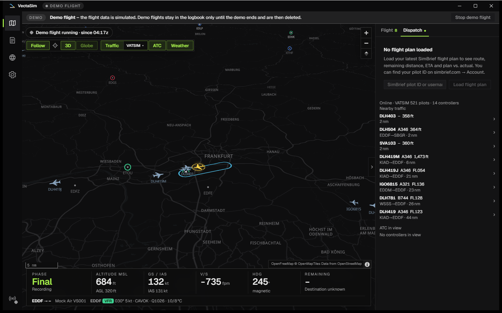
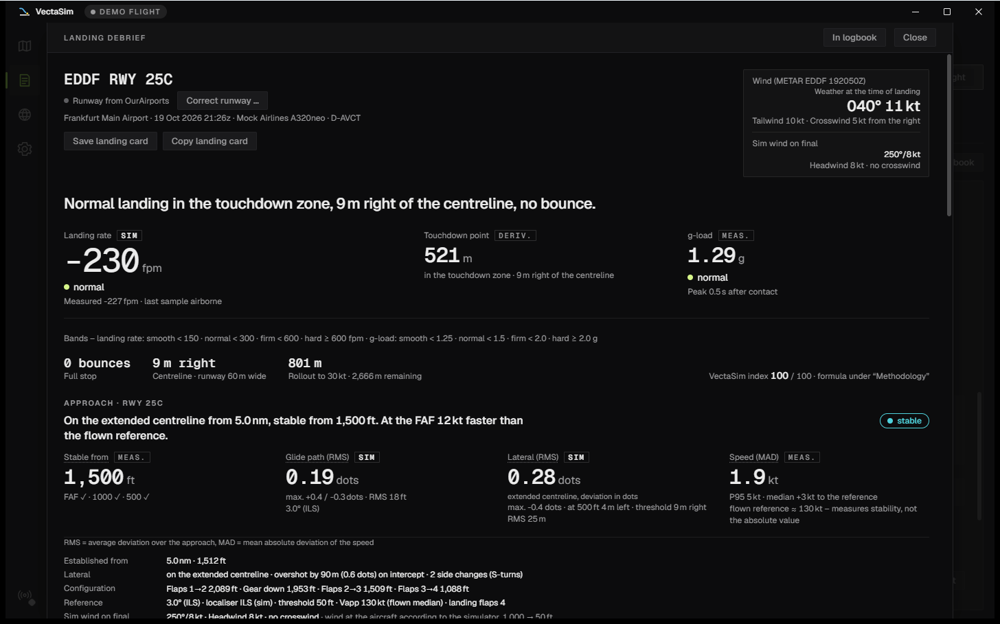
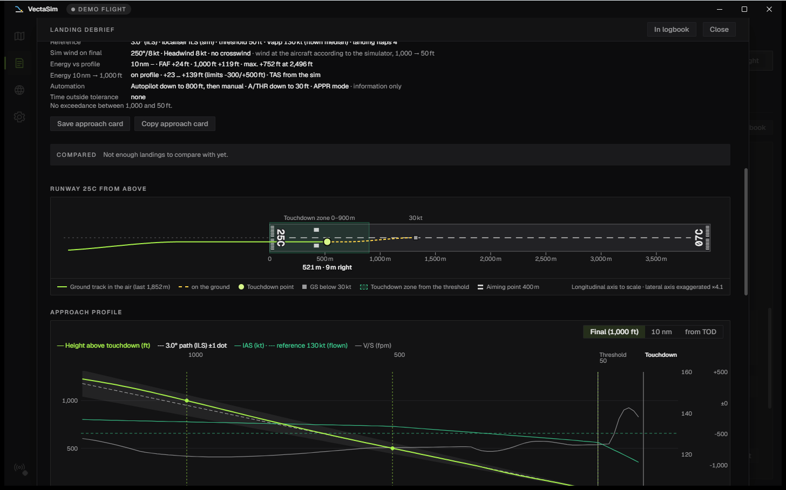
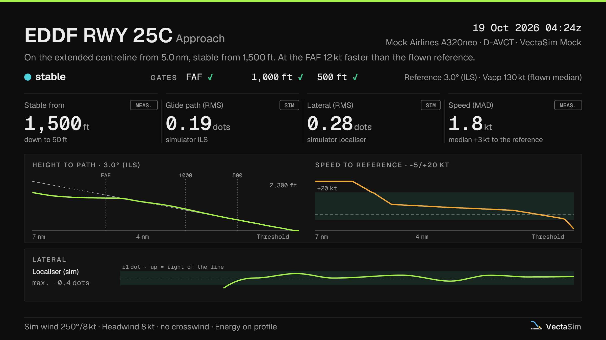
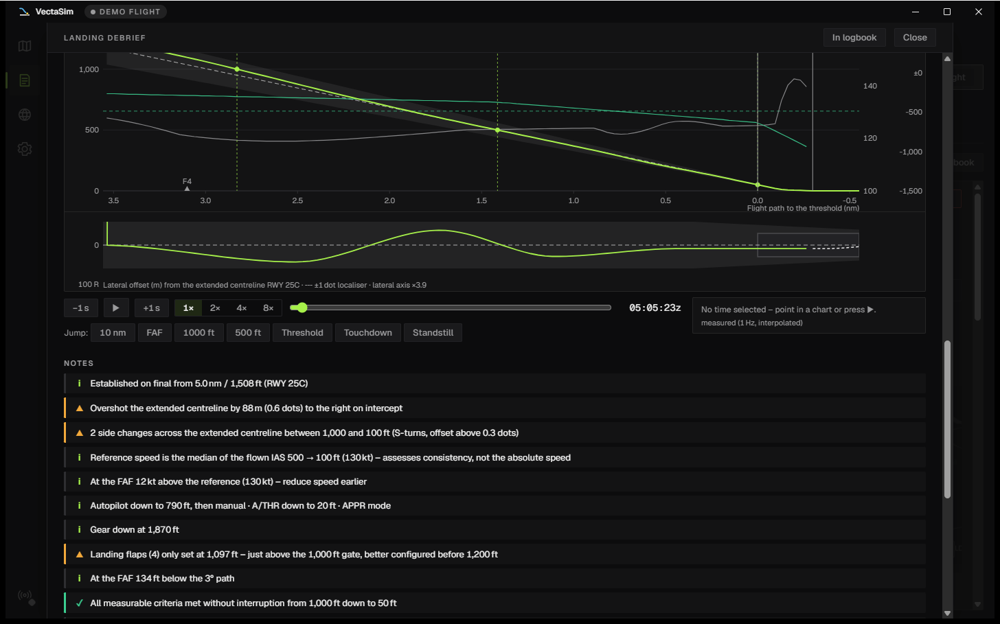
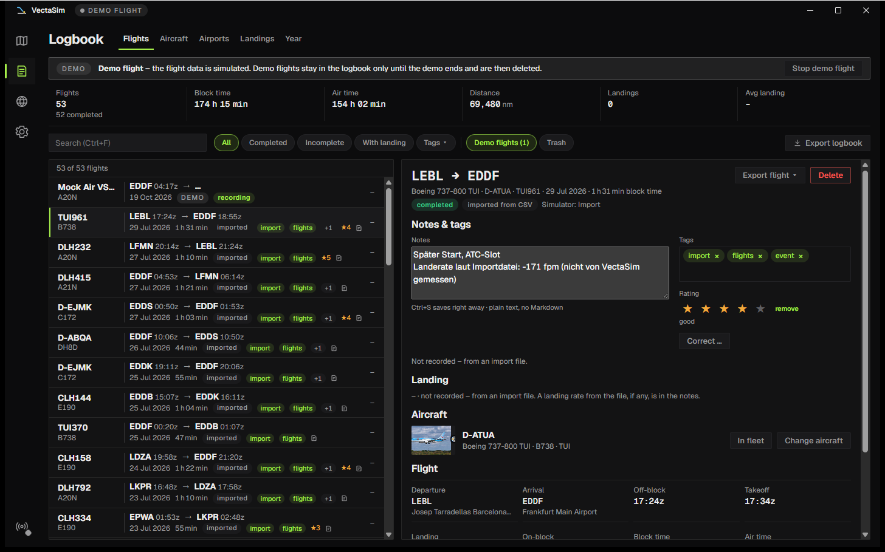
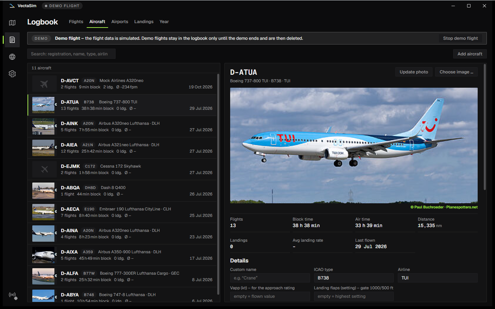
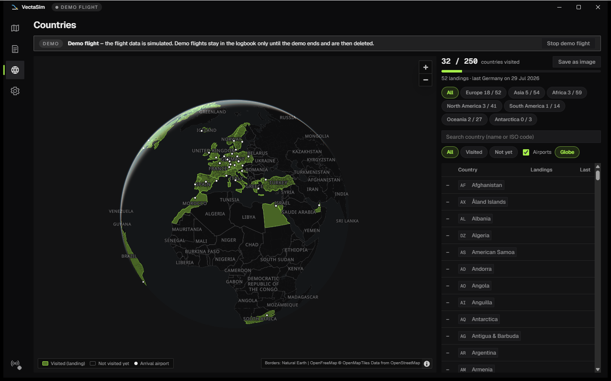

🇩🇪 [Deutsche Version](README.de.md)

  

  Flight tracker and logbook for flight simulators – lightweight, local, with an honest approach and landing analysis.

  
  
  
  
  

  

VectaSim runs alongside Microsoft Flight Simulator 2020/2024 and X-Plane 12.1.1 or later. It detects your flight on its own from the moment you start taxiing until you shut down, records it, and assesses your approach and landing in a way you can trust. No account, no cloud, no subscription: your data stays on your PC; VectaSim only fetches map, weather, traffic, flight plans and photos.

> **Beta.** VectaSim is feature-complete for everyday flying and is now being tested on real setups. It has not yet been tried with every aircraft and add-on. If something looks wrong, an [issue](https://github.com/unwritten-dev/VectaSim/issues) with the diagnostics package from *Settings → Diagnostics* helps a lot – see [If something goes wrong](#if-something-goes-wrong).

## At a glance

| | |
|---|---|
| **Automatic** | Connects to MSFS or X-Plane 12.1.1+, detects off-block, takeoff, landing and on-block and files the flight in the logbook – no button to press. Pause, slew and time acceleration are flagged, not counted. |
| **Approach & landing** | “Stable from … ft”, gates at 10 nm, FAF, 1000 and 500 ft, landing rate with its source, touchdown point on the runway, bounces, go-arounds treated as a decision rather than a mistake. |
| **Live map** | World view as a globe (or flat), your own aircraft, altitude-coloured track, optionally as a 3D altitude profile with a rounded low-poly model of your aircraft class at its flown altitude, airports with taxiways and gates, online traffic and controllers from VATSIM and/or IVAO (click an aircraft for a flight card with route, altitude/trend, distance and a Planespotters photo when the registration is known, with follow, great-circle route and, in 3D, the aircraft’s flown path of the last two hours as an altitude curtain), METAR rings by flight category (VFR/MVFR/IFR/LIFR, explained in a small legend) plus optional precipitation radar and clouds, satellite imagery as an alternative base map, SimBrief route, HUD with phase, altitude, speed, vertical speed, remaining distance and ETA; every block of the side panel collapses and remembers its state. |
| **Logbook** | Flight strips with route, block times, landing rate and a mini runway; fleet by registration with photos; airports; dispersion plots of your touchdowns and approaches; notes, tags, star ratings; year in review. |
| **Countries** | A world globe that colours every country you have landed in – with progress per continent. |
| **Your data** | One SQLite file on your PC, a daily backup to a folder of your choice (OneDrive, NAS …), a trash, export as CSV, GPX, KML and JSON, import of old logbooks (Volanta, SimToolkitPro, VA CSV). |
| **Languages** | English and German UI, following your Windows display language or set by hand. |

## Approach and landing

  

- **The whole approach counts**, not just the touchdown: glide path and lateral deviation in dots, speed against the flown reference, sink rate, bank and configuration at every gate – based on the EASA criteria for stabilised approaches, in four bands from “stable” to “unstable below 500 ft”. With data from the sim, VectaSim also checks against the simulator’s ILS instead of assuming 3°, and takes the sim wind on final, thrust, spoilers and landing flaps into account. ILS reference and sim wind apply to flights recorded with this version; older flights and X-Plane flights are assessed from the runway geometry and the 3° assumption. Lateral tracking gets its own metric and band (RMS and maximum in dots, offset at 500 ft and over the threshold, overshoot when intercepting, S-turns).
- **Energy and wind:** an energy band from 10 nm down to 1000 ft, plus notes on tailwind, crosswind and wind shear on final.
- **Landing rate by fixed, documented rules:** the sim’s touchdown value with a fallback to the last airborne vertical speed, the hardest contact across bounces, never an in-flight peak – the g-load over the whole flight is shown separately in the flight detail. Every number shows its source (sim · measured · derived).
- **Runway top view** with touchdown point, centreline offset, touchdown zone and aiming point; **approach profile** against the 3° glide path with a replay cursor, flare, rollout and the METAR wind at the time of landing. Runways missing from the airport database are derived from your ground track (marked “derived”, threshold ±50 m); *Correct runway …* sets threshold and end exactly.
- **A go-around is a decision:** it gets its own debrief with the lowest point, and the abandoned approach is assessed in full. *Circuits* in the flight detail lists every touch-and-go.
- **You against yourself:** every landing is ranked against your own (“better than 70 % of your last 20 on EDDF 25C”), *Landings → Trends* shows the rolling median over weeks and months, and the dispersion plot shows your last 20 touchdowns and approaches. The same comparison covers how you flew the flight: take-off rotation rate, the height (and distance to the threshold) at which the gear went down, where the landing flaps were set and the stable-approach result (“Rotation 2.3 °/s – your median in the A20N is 2.6 °/s (12 flights)”), with rotation, gear-down height and exceedances as their own trend curves.
- **Landing card to share** (1200 × 675 PNG) with runway, mini approach profile, the four key figures and wind – to the clipboard or as a file, optionally saved automatically after every landing; plus an **approach card** with band, gates, profile and lateral tracking, saved automatically next to the landing card when auto-save is on.

<table align="center">
  <tr>
    <td></td>
    <td></td>
  </tr>
</table>

  

**Lateral tracking** gets its own key figure next to the glide path: the offset from the extended centreline in dots (simulator localiser when available, otherwise geometry), its own band (on track · slight · marked), the offset at 500 ft and over the threshold, overshoot on intercept and S-turns – and the strip under the approach profile shows the whole lateral picture at a glance.

## Logbook, fleet and countries

  

- **Flight strips:** callsign and type, route with block times, landing rate, “stable from … ft”, go-arounds and a small runway with the touchdown point – a list that reveals patterns. Search and filter across everything, including notes and tags.
- **Flight detail:** altitude and speed profile with phases, track map with a **replay** of the whole flight (1× to 64×, the map can follow the aircraft, in 3D at its height), **markers** along the path for gear and flap changes, the take-off rotation rate, touchdowns and the stable-approach gates and exceedances (a *Markers* menu filters them, a click jumps the replay there; from the landing gear extension on the path is green), a **full-screen** view (⛶), times, fuel, plan vs. actual (block time, trip fuel, landing fuel, punctuality) and a PIREP for VA forms as text or JSON.
- **Fleet** (Logbook → Aircraft): flights always land on the same aircraft (registration), with a photo from Planespotters.net or your own picture, and your own Vapp and landing flap setting (e.g. 3 for CONF 3) for the approach rating.
- **Notes, tags, stars** per flight; wrongly recorded values (callsign, airports, aircraft, registration) can be corrected – the original is kept.
- **After a crash:** if you are back within 30 minutes and 5 nm of the last position, VectaSim offers to resume the flight; otherwise *Merge* above the logbook joins the two parts into one flight.
- **SimBrief:** with your pilot ID set, VectaSim loads your current flight plan on its own, shows the route on the map and compares plan and actual.
- **Import:** old flights from Volanta (import CSV), SimToolkitPro, VA exports or VectaSim’s own logbook CSV – with column mapping, preview and duplicate detection. Delimiter, encoding and format are detected automatically; common date formats, times in UTC or local time, weights in kg or lb, files up to 50 MB. A landing rate from the file goes into the notes; imported flights get the tag `import` and count towards hours, routes, fleet and countries.
- **Year in review: story cards as PNG** (“Your year 2026”, Logbook → Year): seven cards – overview, routes with world map, fleet, landings with a yearly dispersion plot, approaches, months, countries – plus an optional eighth, “With an asterisk” (flights with pause, time acceleration, slew or a position jump). Story portrait format 1080 × 1920 or landscape 1200 × 675, for a calendar year or the last 12 months. Save or copy them one by one, with *Save each one* into a folder, or with *All as one long image* as a portrait stack; streamer mode masks the registrations.

  

  

**Countries** (Ctrl+3): every country you have landed in is coloured in – only the arrival counts. Progress overall and per continent, first and last landing per country, one click shows the flights there; the map can be saved as an image.

## Interface

- Four views – Map, Logbook, Countries, Settings (Ctrl+1 to 4) – and six themes (Signal, Night Cockpit, Graphite & Amber, Phosphor plus the day themes Paper Chart and Arctic Studio). Times in UTC or local time, weights in kg or lb, the whole interface scalable with Ctrl+Plus/Minus.
- **Keyboard:** Ctrl+F searches the logbook, Ctrl+. collapses the map’s side panel, Enter opens the debrief of the selected flight, Del moves it to the trash, Alt+T jumps to the newest notice – the full list is under *Settings → Keyboard*.
- **Map:** switch between globe and flat map in the map bar or under *Settings → Display*; rotate and tilt the 3D view with the right mouse button or Ctrl + drag.
- **English and German:** *Settings → Display → Language* – System (follows your Windows display language), Deutsch or English, applies immediately. Notifications, tray menu, Discord status, overlays and the installer follow the same setting; flight phases are always shown in English.
- **Streamer mode** (Ctrl+Shift+P) hides registrations, callsigns, airline, SimBrief ID and user paths everywhere – including the landing card and the diagnostics package; the diagnostics package leaves out your Windows user name even without it.
- **Landing rate in the sim (MSFS):** a few seconds after touchdown a line at the top of the screen shows rate, band, g, bounces and touchdown point, e.g. “VectaSim · Landed -142 fpm (smooth) · 1.18 g · no bounces · 27L: 412 m past the threshold, 1 m left” (*Settings → Simulator*, on by default; depends on the MSFS version showing SimConnect text – *Send test message to the sim* there tells you whether yours does).
- **Integrations** (all optional, off by default except notifications and the tray icon): Discord status with route and phase (off by default, turn it on under *Settings → Integrations*; no Discord app of your own needed – activity sharing must be allowed in Discord), Windows notifications (landing, flight saved, connection, update), an icon in the notification area: minimising or closing the window keeps VectaSim running there (recording included); double-click the icon to open it again, *Quit* in its menu ends the app (switchable under *Settings → Integrations*).
- **Overlay & API** (off by default): a local server with transparent OBS overlays (HUD, landing, route); open the overlays and start page on a tablet or phone on your Wi-Fi (with token); plus a read-only JSON/WebSocket API for virtual airlines. Overlays accept `?lang=de|en` – endpoints and security in [docs/overlay-api.md](docs/overlay-api.md).
- **Data safety:** a daily backup (the last 7 daily backups are kept), plus one before every update and every data format migration, to a folder of your choice; restore with one click; deleted flights stay in the trash for 30 days; a full export as a `.vectasim` file to move to another PC. *Empty trash* and *Delete all data* are under *Settings → Data*.
- **Demo flight** to try things out without a simulator – it starts in the air on the downwind for Frankfurt and lands after about 4 minutes, normally, with a few small, deliberate mistakes so the debrief has something to show. Demo flights are removed when the demo ends; until then they only appear in the logbook and statistics with the “Demo flights” filter.
- **Updates:** automatic updates are verified with VectaSim’s own signature; the installer itself is not yet code-signed for Windows. During a recorded flight, updates wait until the flight is over, and quitting asks first (the flight is then saved as interrupted).

## System requirements

- Windows 10 or 11, 64-bit, with WebView2 (preinstalled on current Windows).
- Microsoft Flight Simulator 2020 or 2024 (Microsoft Store or Steam) or X-Plane 12.1.1 or later, on the same PC.
- An internet connection for the map and online data (weather, traffic, flight plans, photos).
- A window of at least 1024 × 640.

## Installation

1. Open the latest version under [Releases](https://github.com/unwritten-dev/VectaSim/releases) and download `VectaSim_<version>_x64-setup.exe` (Windows 10/11, 64-bit).
2. Run the installer. Windows SmartScreen reports an “unknown publisher” (the beta is not code-signed yet) → *More info → Run anyway*. No admin rights needed.
3. VectaSim needs Microsoft’s `SimConnect.dll` for MSFS. At the end, the installer offers to fetch it from Microsoft – one click, about 108 MB; it verifies the file and keeps only the DLL (if the MSFS SDK is already installed, it doesn’t ask). You can also do this later under *Settings → Simulator → Download SimConnect*. X-Plane needs no extra file – if you only fly X-Plane, answer “No”.
4. Start MSFS or X-Plane. As soon as the sim is in the main menu (MSFS) or a flight is loaded (X-Plane), the map shows “Ready”; recording starts when you taxi.

*Settings → Simulator* defaults to *Automatic*: if no MSFS is found within 10 seconds, VectaSim tries X-Plane. If you only fly X-Plane, choose “X-Plane 12”. For X-Plane, *Settings → Network → Disable Incoming Traffic* in X-Plane must stay off, otherwise the Web API is blocked.

VectaSim announces updates at startup and installs them after you confirm. More details, the SDK route, X-Plane setup and troubleshooting are in [docs/installation.md](docs/installation.md).

## Your data & privacy

- Your logbook lives in `%APPDATA%\io.vectasim.app\`; logs and the default backup folder are in `%LOCALAPPDATA%\io.vectasim.app\`.
- VectaSim only contacts: OpenFreeMap (map tiles), EOX (satellite tiles, only with “Satellite” on), RainViewer and EUMETSAT (radar and clouds, only when turned on), aviationweather.gov (METAR; if it fails and VATSIM traffic is on, `metar.vatsim.net`), VATSIM and IVAO (traffic, only when turned on; the VATSIM data address is only accepted on vatsim.net), SimBrief (only with your pilot ID), Planespotters.net (aircraft photos, can be turned off), GitHub (updates), Microsoft’s SDK server (only for the SimConnect download) and Discord (only the local Discord client, only with the Discord status on).

## Uninstall

Windows *Settings → Apps → VectaSim → Uninstall*. Your logbook stays unless you tick “Delete app data” – that also removes the backups in the default folder, so keep a backup elsewhere first.

## If something goes wrong

*Settings → Diagnostics* shows the connection, the DLL that was found and the data rate; *Copy diagnostics* puts a short summary on the clipboard. For a bug report: turn on **Debug mode**, reproduce the problem, click **Create diagnostics package** – attach the ZIP file (logs, settings, simulator recording; no passwords or keys) to an [issue](https://github.com/unwritten-dev/VectaSim/issues). Then turn debug mode off again.

## Known limitations

- **X-Plane:** 10 values per second, no touchdown value from the sim – the landing rate is “measured” (about ±50–100 fpm), no ILS reference; X-Plane on this PC or in your local network only (public addresses are refused).
- Imported flights have no track and no landing analysis.
- Derived runways are accurate to about ±50 m.
- Flight phases are always shown in English.
- The installer is not code-signed yet.
- The precipitation radar comes from RainViewer’s free tier, which RainViewer offers for personal and educational use only (zoom ≤ 7, one colour scheme).

## Status

Beta 0.5 – MSFS 2020/2024 and X-Plane 12.1.1+ (Web API), English and German UI. Planned: Volanta JSON import, code signing – ideas welcome as an [issue](https://github.com/unwritten-dev/VectaSim/issues). What has changed is in the [CHANGELOG](CHANGELOG.md).

## Contributing

Everything for developers – stack, building from source, architecture, conventions – is in [DEVELOPMENT.md](DEVELOPMENT.md).

## Data and credits

Map: © [OpenStreetMap](https://www.openstreetmap.org/copyright) contributors, tiles by [OpenFreeMap](https://openfreemap.org) · Satellite imagery: [EOxCloudless](https://cloudless.eox.at) by EOX IT Services GmbH (contains modified Copernicus Sentinel data 2017, CC BY 4.0) · Airports: [OurAirports](https://ourairports.com) (public domain) · Country borders: [Natural Earth](https://www.naturalearthdata.com) (public domain) · Weather: NOAA aviationweather.gov, radar by [RainViewer](https://www.rainviewer.com), clouds: contains modified [EUMETSAT](https://www.eumetsat.int) Meteosat data · Online traffic: [VATSIM](https://vatsim.net) · [IVAO](https://ivao.aero) · Flight plans: [SimBrief](https://www.simbrief.com) · Aircraft photos: [Planespotters.net](https://www.planespotters.net) with photographer credit.

SimConnect is part of the Microsoft Flight Simulator SDK and is not bundled; on request VectaSim downloads `SimConnect.dll` from Microsoft’s official SDK download.

Thanks to **npooky** for the first flight test in the real simulator.

Licenses of the libraries, fonts and data used: [THIRD-PARTY-NOTICES.md](THIRD-PARTY-NOTICES.md).

## License

MIT – see [LICENSE](LICENSE).
