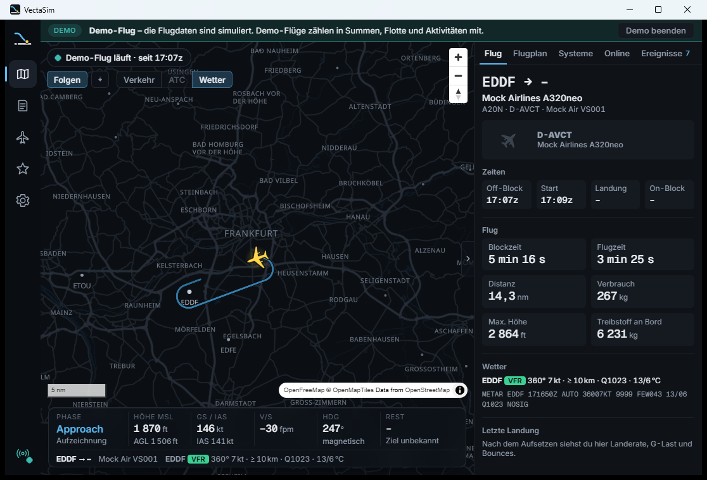

  

  Flight-Tracker und Logbuch für Flugsimulatoren – leicht, lokal, mit ehrlicher Landeauswertung.

  

VectaSim läuft neben Microsoft Flight Simulator 2020/2024, erkennt deinen Flug automatisch vom Losrollen bis zum Abstellen, zeichnet ihn auf und wertet die Landung so aus, dass du den Zahlen trauen kannst. Alles bleibt auf deinem PC – kein Konto, keine Cloud.

## Funktionen

**Automatisch aufzeichnen**
- Verbindung zu MSFS 2020/2024 über SimConnect, ohne Konfiguration; verbindet sich neu, wenn der Sim neu startet
- Flugphasen (Taxi, Takeoff, Climb, Cruise, Descent, Approach, Final, Landing, Taxi in, Shutdown) mit robusten Schwellwerten; Pause, Slew und Zeitraffer werden erkannt und markiert, nicht mitgezählt
- Off-Block, Start, Landung, On-Block, Blockzeit, Flugzeit, Distanz, Treibstoffverbrauch

**Landeauswertung**
- Landerate nach festen, dokumentierten Regeln: Sim-Wert mit Rückfall auf die letzte Sinkrate in der Luft, härtester Kontakt bei Bounces, kein Flug-Peak – jede Zahl zeigt ihre Herkunft (Sim · gemessen · abgeleitet)
- Runway-Draufsicht mit Aufsetzpunkt, Mittellinien-Versatz und Touchdown-Zone; Anflugprofil gegen den 3°-Gleitpfad; Stabilized-Approach-Checkliste bei 1000 und 500 ft; Abfangen, Rollout, Gegen-/Seitenwind aus dem METAR zum Landezeitpunkt
- Ein Kernsatz, drei Kennzahlen, Hinweise in Klartext; der „VectaSim-Index" steht klein darunter – mit sichtbarer Formel
- Nach dem Aufsetzen eine Karte auf der Live-Ansicht, die du auch nach dem Alt-Tab aus dem Sim noch siehst

**Live-Karte**
- Vollbild-Karte mit eigenem Flugzeug (Silhouette und Größe nach Wirbelschleppen-Klasse), höhencodiertem Track, Flughäfen und beim Hineinzoomen Taxiways, Gates und Runways
- VATSIM-Verkehr und ATC, METAR-Wetter als Badges, geplante Route aus SimBrief
- HUD mit Phase, Höhe, Geschwindigkeit, Sinkrate, Kurs, Restdistanz und ETA

**Logbuch, Flotte, Flugplan**
- Lokales Logbuch mit Suche, Filtern, Höhen-/Speed-Profil, Track-Karte, Export als CSV, GPX, KML (Google Earth) und JSON
- Flotte nach Kennzeichen: Flüge landen immer auf demselben Flugzeug, mit Foto von Planespotters.net oder eigenem Bild
- SimBrief-Flugplan laden, Route auf der Karte, Soll/Ist für Blockzeit und Landetreibstoff

**Oberfläche**
- Sechs Themes (Signal, Nachtcockpit, Graphit & Amber, Papierkarte, Phosphor, Arktis Studio), integrierte Titelleiste, Zeiten in UTC
- Demo-Modus ohne Simulator, signierte Auto-Updates

## Installation

Installer aus den [Releases](https://github.com/unwritten-dev/VectaSim/releases) (Windows 10/11). Beim ersten Start braucht VectaSim eine `SimConnect.dll` – Details, SDK-Hinweise und der Weg über den Quellcode stehen in [docs/installation.md](docs/installation.md).

## Status

Phase 1 (MVP) in Arbeit. Die Erkennung läuft stabil gegen den eingebauten Demo-Flug; die erste Verifikation gegen echtes MSFS steht aus ([Checkliste](docs/sim-pc-checklist.md)). X-Plane folgt.

## Mitmachen

Technische Doku, Architektur und Konventionen: [DEVELOPMENT.md](DEVELOPMENT.md). Releases: [docs/releasing.md](docs/releasing.md). Änderungen: [CHANGELOG.md](CHANGELOG.md).

## Daten und Danke

Karte: © [OpenStreetMap](https://www.openstreetmap.org/copyright)-Mitwirkende, Tiles von [OpenFreeMap](https://openfreemap.org) · Flughäfen: [OurAirports](https://ourairports.com) (Public Domain) · Wetter: NOAA aviationweather.gov · Online-Verkehr: [VATSIM](https://vatsim.net) · Flugpläne: [SimBrief](https://www.simbrief.com) · Flugzeugfotos: [Planespotters.net](https://www.planespotters.net) mit Fotografen-Credit.

SimConnect ist Bestandteil des Microsoft Flight Simulator SDK und wird nicht mitgeliefert.

Lizenzen der verwendeten Bibliotheken, Schriften und Daten: [THIRD-PARTY-NOTICES.md](THIRD-PARTY-NOTICES.md).

## Lizenz

Lizenz: MIT – siehe [LICENSE](LICENSE).
