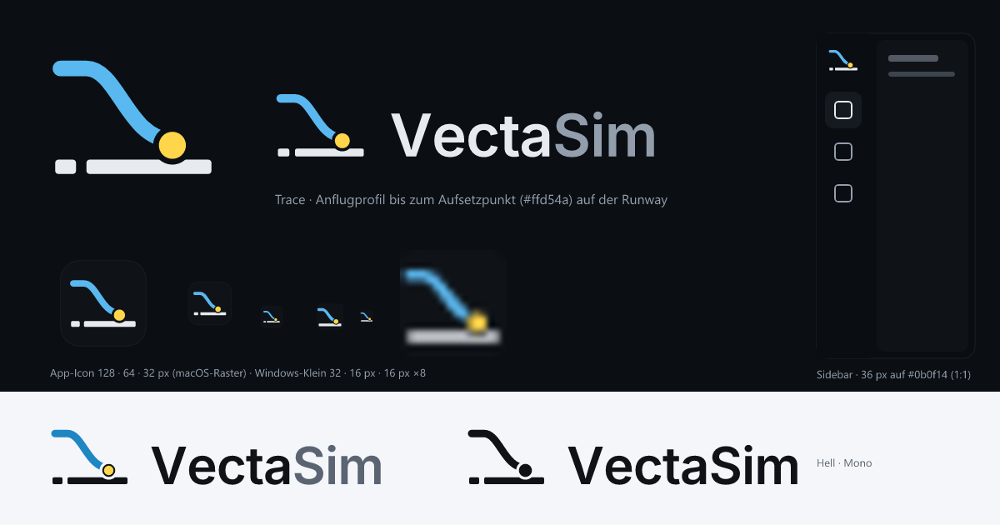

# VectaSim – Brand

The mark is called **“Trace”**.

## The mark

The mark consists of **one** line, the approach track. It runs level at first, then descends in a calm curve and flattens into the flare. It ends in the **yellow touchdown point**, which sits on the **runway**. The runway is a strong baseline, with a short dash of the extended centreline in front of it. The mark contains no letter shape.

- **Track (accent `#5ab8f0`)**: the approach profile from the debrief, reduced to a glyph. In the app, cyan stands for the actual value, like the blue air track in the “Runway from above” chart.
- **Point (`#ffd54a`)**: the touchdown. It has the yellow of the own aircraft and is set free by a gap, so it stays readable in a single colour as well.
- **Baseline (text colour)**: the runway. The threshold with the centreline dash in front of it is on the left, the point sits just past it, the roll-out follows on the right.

The word mark is set in Inter (© The Inter Project Authors, SIL OFL 1.1) as outlines.

### Legibility

- **512 px / app icon**: track, flare, gap ring, threshold and centreline dash are visible.
- **32 px**: step, point and baseline are clear. The centreline dash is still there as a dot.
- **16 px**: the silhouette “step on a line with a yellow point” remains. For ≤ 48 px there is a **small variant**. It is solid, has a stroke width of 7 instead of 6, a larger point and a continuous baseline without the centreline dash. It is used for `32x32.png`, `Square30x30Logo.png`, `Square44x44Logo.png` and the 16/24/32/48 entries in `icon.ico`.
- **Contrast on `#0b0f14`**: text 16:1, accent 8.7:1, yellow 13.6:1.
- **Contrast on light `#f4f6f9`**: ink `#0f1318` 17:1, accent `#1f86c4` 3.7:1. Yellow reaches only 1.3:1, so the point gets an ink outline instead of a darker yellow, because yellow is the aircraft colour.

## Files

| File | Purpose |
|---|---|
| `logo.svg` | Mark for dark surfaces (64 grid, transparent) |
| `logo-on-light.svg` | Mark for light surfaces |
| `logo-mono.svg` | Single colour with `currentColor` (default `#0f1318`); the point is set free with a mask |
| `logo-wordmark.svg`, `-on-light`, `-mono` | Mark plus “VectaSim” (Inter SemiBold, −14 ‰, as paths). “Vecta” is in the text colour, “Sim” in muted. The baseline of the type sits on the lower edge of the runway. |
| `app-icon.svg` | 1024 canvas on the macOS grid: body 824 with a 100 margin, r = 185. Opaque inside, fully transparent outside. |
| `preview.png` | Overview 1200 × 630 |

Derived from them:

- `app/src-tauri/icons/*`: generated from the app icon with `tauri icon`, then `icon.ico`, `32x32.png` and `Square30/44` overwritten with the small variant.
- `app/public/favicon.svg`
- `app/src/ui/Logo.tsx`

Cargo does not re-embed changed icons by itself, so after a change run `cargo clean -p vectasim && cargo build -p vectasim`.

## Rules

**Clear space**: keep at least the diameter of the gap ring free all around, i.e. 15 of 64 units (≈ ¼ of the mark’s width).

**Minimum size**: the full mark from 24 px. From 16 to 23 px only the small variant or mono. The word mark from 20 px height.

**Colours**

| Role | Dark | Light |
|---|---|---|
| Track | `#5ab8f0` (`--accent`) | `#1f86c4` |
| Runway, “Vecta” | `#e7ebf0` (`--text`) | `#0f1318` |
| Touchdown point | `#ffd54a` | `#ffd54a` + outline `#0f1318` |
| “Sim” | `#939eac` (`--text-muted`) | `#5a6472` |
| Icon surface | `#0f1318`, hairline `rgba(200,220,255,.12)` | – |

**Not allowed**

- Gradients, shadows, gloss or 3D. No gradient square behind the mark.
- Adding a second line, an aircraft, a globe or a contrail.
- Building letters into the mark.
- Colouring the point anything but yellow (exception: mono).
- Swapping the colours of track and runway.
- Mirroring, rotating or distorting.
- Drawing the curve steeper or flatter, or removing the flare.
- Removing the gap ring.
- Setting “VectaSim” in another typeface or spelling, or “Sim” lighter than “Vecta”.
- Placing the mark on busy map areas without a surface behind it.

## In the app

`<Logo size={28} />` from `app/src/ui/Logo.tsx`. The runway is `currentColor` (`--text` in the sidebar), the track `var(--accent)`, the point always `#ffd54a`. With `mono` the track becomes `currentColor` as well. In the sidebar the surface stays 36 px and has no gradient.
